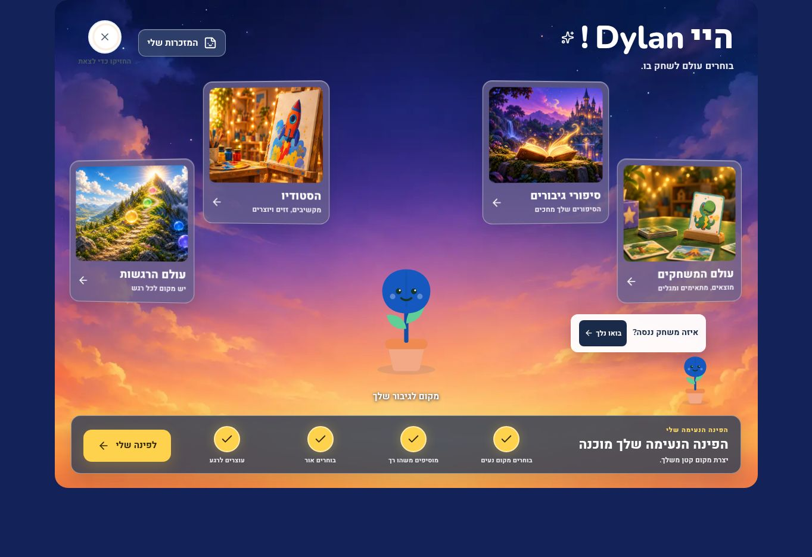
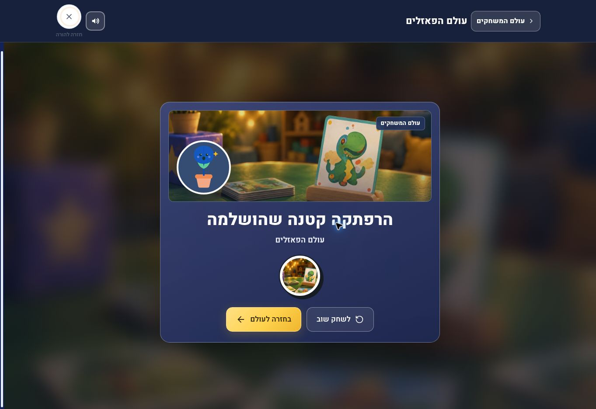

# Kids Studio V2 — observed layouts and resolved reward fix

**Candidate:** [PR #137](https://github.com/guyrubin/Arbor/pull/137), runtime source `70f6ef1a2214251c7a066fc10a104ea511241cc0`, on the preserved Parent V3 baseline `cfc2cf068a59909617107ebf0ccbbfe3d27d68ce`. Observations below were reported by the release owner on 13 October 2026. The observed appearance passed for the inspected screens and sizes; the subsequently found quest/game reward defect is fixed in `70f6ef1a` with 38 focused regression tests passing; final Node 22 TypeScript and 79 tests across seven suites passed. These are synthetic browser checks, not private family or real-device verification.

## Observed fixes

| Finding | Change and current evidence |
|---|---|
| Parent typography leaked into child headings | Parent serif/navy heading rules overrode the Sky's child register. The candidate explicitly scopes white Nunito/Heebo sans headings to the V2 child surface and overlay title. Desktop EN/HE Home and Playbank, and the latest Hebrew game intro, were observed with the corrected treatment. Parent V3 source remains preserved. |
| Game introduction/result reverted to beige practice panels | Final game-flow styling restores the Sky's neutral blurred environment, dark-glass panel, image window, avatar/fallback medallion and gold primary action. Latest Hebrew intro and actual post-completion result passed visual inspection; replay and Back are visible. The attached verified result capture shows the final composition. |
| Quest and collection reverted to beige standalone panels | `47387c30` aligns these surfaces with the Studio Sky shell. Quest choice/persistence/completion, final collection and completed-quest styling passed. The final quest uses the sky, neutral room window and dark panel, without a duplicate inner Home action. |
| Quest reward marked an unplayed game saved | Operated UI exposed a shared `calm-builder` reward reference between the cozy-corner quest and the separate Calm Builder game. Resolved by `70f6ef1a`: distinct `kid-quest` reference, quest collection label and `onQuest` route. The implementing agent reports 38 focused tests passing, including a quest-only ledger that leaves Calm Builder unearned and a collection item that opens the quest. These regressions, not the earlier appearance/count checks, establish this fix. |
| Images disappeared during dynamic fixture resize | Fresh loading of the corresponding frame showed the images correctly. No app source change was made for this fixture-only observation. This does not establish general real-device rotation coverage. |

## Observed layouts and flows

| Check | Observation |
|---|---|
| Desktop EN | Home and Playbank viewed successfully; exact desktop dimensions were not supplied with this receipt. |
| Desktop HE | Home and Playbank viewed successfully with RTL copy and corrected child headings. |
| 390px mobile EN | Fresh-frame Home rendering passed the release owner's inspection. |
| 820px tablet HE | Fresh-frame Home rendering passed the release owner's inspection. |
| Latest Hebrew game intro | Neutral blurred scene, centered 640px dark-glass composition, 260px image window, canonical Sprout fallback medallion, white sans text, one gold primary action and overlay Back were observed. These dimensions describe the inspected layout, not every breakpoint. |
| Puzzle completion/replay | Operated the actual four-piece puzzle through completion, new sticker and collection. Completed four real pieces again: no repeated new-sticker message. Final collection contains one puzzle keepsake despite two completions, plus one completed quest keepsake; the Hebrew world card showed “נשמר”. |
| Finite quest | Operated four meaningful choices. Two completed steps persisted after reload; the final `middle`, `blanket`, `lamp`, `quiet` choices remained, and completion appeared correctly at Home. Final completed-quest style passed. |
| Actual Calm Builder | Release owner observed finish disabled initially, placed a cushion in slot 1, selected dusk, then used the enabled finish action to reach the dark-glass result. An old local quest record existed, so this run does not establish a new-reward award. |

## Verified synthetic screenshots

These two 1363×936 captures were selected and viewed by the release owner and documentation agent. They contain a synthetic Dylan name and Sprout fallback, not a private family avatar. Earlier blank fixture/resize captures are deliberately excluded.

## Remaining verification

- Quest/game reward separation is fixed and covered by the 38 focused checks above; final integrated Node 22 TypeScript and 79 tests / seven suites passed.
- Observed layout appearance passed; remote CI and production verification are separate receipts.
- Complete all-world/game/book/exit journey and broader device matrix: do not infer from the observed subset.
- Actual current-profile avatar versus current-hero screens: private authentication was declined, so no personal likeness claim is made. The inspected Sprout fallback is not a substitute for this proof.
- Real iOS/Android audio, interruption/rotation, native-speaker editorial review, text enlargement and representative-network performance require their own evidence.
- Remote CI, production deployment and post-deploy checks remain pending in the [release record](kids-studio-v2-2026-10-13.md).

The implemented source preserves the profile avatar boundary and historical book artwork; the four neutral portal scenes contain no child identity. This checklist separates observed appearance from the resolved reward correctness fix and from broader real-family, physical-device and production claims.
